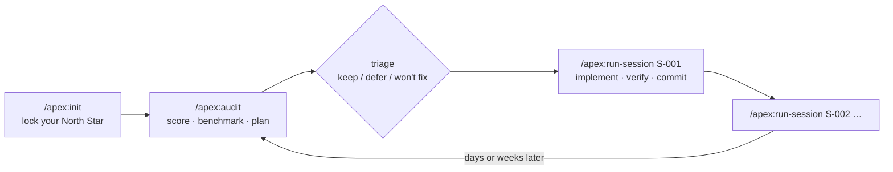

<p align="center">
  
</p>

<h1 align="center">Apex — Project Optimizer & Strategist</h1>

<p align="center">
  <b>Your repo's staff engineer: audits, benchmarks, and plans — without touching your code.</b><br>
  A Claude Code plugin that scores your project 1.0–10.0 with evidence, mines competitors' weaknesses,<br>
  and keeps a living roadmap of 1–2 hour sessions you can run one command at a time.
</p>

<p align="center">
  <a href="https://github.com/Kakumrkr/apex/actions/workflows/ci.yml"></a>
  <a href="LICENSE"></a>
  
  
</p>

---

## Why Apex?

AI coding agents are great at *doing* work and bad at deciding *which* work matters.
They forget what you rejected last week, score your project differently every
time you ask, and will happily "improve" your code while they're supposed to be reviewing it.

Apex fixes that with a strict separation of concerns:

- 🔍 **An auditor that can't write code.** Hooks restrict it to `.apex/` files and a read-only Bash allowlist. This is enforced, not just requested in the prompt.
- 📏 **A score you can trust.** 8 weighted dimensions, each backed by `file:line` evidence, recomputed by a linter. A broken build caps the score at 4.5.
- 🌐 **Competitor research that can't be invented.** Every "verified" claim must cite a URL the agent actually saw.
- 🧠 **Memory of your decisions.** Won't-fix and deferred ideas are never re-suggested and never cost you points.
- 🧩 **Sessions you can finish.** 1–2 hour packets with target files, patterns to mirror, do-not-touch lists, Definition-of-Done commands, and parallel-safety tags.

## Install

In Claude Code (2.1.275+):

```text
/plugin install apex --marketplace Kakumrkr/apex
```

Or in two steps:

```text
/plugin marketplace add Kakumrkr/apex
/plugin install apex@kakumrkr
```

**Requirements:** `git` and `python3` (3.9+) on your `PATH`. No pip installs.
**Auto-detected stacks:** JavaScript/TypeScript (npm, pnpm, yarn, bun) and Python. Other stacks can add checks to `config.json` by hand.

## The workflow



| Command | What it does | Model |
|---|---|---|
| `/apex:init` | Interviews you to lock the **Product North Star** (audience, value prop, competitors, non-goals) and confirms which health checks Apex may run. | your session |
| `/apex:audit [quick\|standard\|full]` | Progress review since the last audit → real health checks → rubric score → competitor research → roadmap + session packets → **interactive triage**. | Opus · high (`quick`: Sonnet, no web) |
| `/apex:run-session <id> [--branch\|--worktree]` | Preflight → implement inside the packet's targets → run its Definition of Done → mark done → atomic commit. | your session (packets recommend Sonnet or Opus) |
| `/apex:status` | Dashboard: score trend, tier, dimensions, sessions ready to run in parallel. | Sonnet · low |
| `/apex:defer <idea\|id>` | Records a Won't Fix / Deferred decision so audits respect it forever. | your session |

## Try it now, with zero tokens

The repo ships a fully worked example: a fictional SaaS taken through three audits by the real CLI.

```bash
git clone https://github.com/Kakumrkr/apex.git && cd apex
python3 scripts/apex.py status --project-dir examples/demo-saas
```

```text
APEX · Tasklane (fictional demo)

Score   6.8 / 10  ▲ +1.7 since 2026-10-12
Tier    Tier 2 · Reliability (UX states, errors, edge cases)
Trend   ▃▄▆  (3 audits)
Audit   2026-11-07 (1d ago) · standard · c47e9f2

Dimensions
  Core loop & functionality      ████████░░ 8.0
  Data & schema integrity        ███████░░░ 7.0
  UX states & onboarding         ███████░░░ 6.5
  Type safety & code health      ████████░░ 7.5
  Error handling & resilience    ██████░░░░ 6.0
  Performance                    ███████░░░ 6.5
  Tests & CI                     ██████░░░░ 6.0
  Security & privacy             ██████░░░░ 6.0

Sessions  5 done · 1 in progress · 3 todo · 0 blocked · 1 dropped
  ▶ in progress: S-007 Cmd+K command palette for clients, tasks, and weeks
  Ready now:
    S-008  Optimistic drag-to-reschedule with instant undo  [Opus · Parallel-Safe · ~2h]
    S-009  GitHub Actions CI running typecheck, lint, and tests  [Sonnet · Parallel-Safe · ~0.75h]
  Run in parallel (git worktrees): S-008, S-009
  Next: /apex:run-session S-008

Decisions  1 won't-fix · 1 deferred
```

Now watch the linter catch an auditor that inflates the score, fabricates a source, and re-proposes something you rejected:

```text
$ python3 scripts/apex.py lint --project-dir <tampered copy of the demo>
ERROR score-math [.apex/roadmap.md]: overall 8.4 must equal the weighted rubric score 6.83 (±0.15)
ERROR provenance [.apex/roadmap.md]: row 6: https://boardly.example.com/blog/no-offline-support was never observed via WebSearch/WebFetch (not in .apex/.search-log.json or committed research). Mark it 'unverified' or fetch the page first.
ERROR wont-fix [.apex/roadmap.md]: 'sso-login' was rejected as WF-001 (Explicit non-goal: solo freelancers, not teams). Remove it.
apex lint: 3 error(s)
```

In a real audit, this same check runs as a `SubagentStop` hook, so the auditor **can't finish** until it fixes these.
Browse [`examples/demo-saas/.apex/roadmap.md`](examples/demo-saas/.apex/roadmap.md) to see the full output: the score trend chart, parity matrix, session graph, and packets.

## Field-tested

Apex was run end to end with headless Claude Code on a small TypeScript project:

| Step | Result | Time | Cost |
|---|---|---:|---:|
| `/apex:audit quick` (first audit) | 2.7/10, Tier 1, 4 packets; vacuous test suite flagged; lint passed on first finalize | 2m | $0.40 |
| `/apex:run-session S-001` | implemented inside targets, 5 real tests, DoD green, atomic `feat(apex): S-001 …` commit | 1m | $0.37 |
| `/apex:audit quick` (delta) | 3.3/10 (+0.6); credited S-001 *and* caught a side effect it introduced, then planned S-005 to fix it | 1.3m | $0.32 |

Across these runs the guards denied a heredoc edit, file redirection, and an unlisted `sed`, and the auditor adapted each time. No source file was changed by any audit.
Numbers are from `quick` mode on a tiny repo. `standard`/`full` audits on Opus with web research cost more.

## What an audit produces

```text
.apex/
├── north-star.md          🔒 your locked Product North Star
├── decisions.md           🔒 append-only Won't Fix (WF-###) / Deferred (DF-###) log
├── roadmap.md             score + evidence, health, progress review, First-60-Seconds,
│                             parity matrix, ROI-ranked opportunities, session plan
├── sessions/S-007-*.md    self-contained 1–2h context packets (status in frontmatter)
├── research/competitors.md  cached research with sources + refresh date
├── history/2026-11-07-audit.md  🔒 immutable snapshot of every audit
├── state.json             🔒 score history, tier, last audited commit
└── config.json            stack + the health checks you approved
```

🔒 = Claude's Write/Edit tools are blocked on these for **every** agent. Changes go through `apex.py`.

## How it works

<details>
<summary><b>Maturity tiers (with hysteresis)</b></summary>

| Tier | Score | Focus |
|---|---|---|
| 1 · Foundations | 1.0–4.5 | Core loop, schema stability, type safety, a green build. Light competitor check only, no polish. |
| 2 · Reliability | 4.6–7.5 | Loading/empty/error states, error boundaries, edge cases, onboarding friction. |
| 3 · Market leader | 7.6–10.0 | Differentiators from competitor weaknesses, micro-delighters (⌘K, optimistic UI, instant undo). |

You're promoted only at `floor + 0.3` and demoted only at `floor − 0.3`, so a project at 4.6 doesn't flip-flop between tiers.
An **anti-bloat filter** rejects SSO/RBAC/multi-tenancy-style work unless your North Star audience needs it.
</details>

<details>
<summary><b>The rubric</b></summary>

Core loop 20 · Data integrity 15 · UX & onboarding 15 · Code health 10 · Resilience 10 · Performance 10 · Tests & CI 10 · Security 10.

`overall` must equal the weighted mean (±0.15). If a *required* health check fails, `overall ≤ 4.5`.
A move of more than 1.5 points from the last audit needs a written `delta_justification`. Full anchors are in [`rubric.md`](skills/audit/references/rubric.md).
</details>

<details>
<summary><b>Delta mode: cheap repeat audits</b></summary>

After the first audit, the auditor:
- spends ~80% of its reading on `git diff <last_audit_sha>..HEAD`
- reuses its codebase map from project memory (`.claude/agent-memory/apex*/MEMORY.md`)
- spot-checks 2–3 untouched modules

Research is cached for 28 days. `/apex:audit full` forces a complete re-scan; `--refresh` forces new research.
</details>

<details>
<summary><b>Session Context Packets</b></summary>

Each packet is self-contained, so a fresh session can execute it cold. It lists:
- **targets** (≤5 files) and **patterns** (existing files to mirror for style)
- **do-not-touch** paths
- **model** tier: `Sonnet · Standard Execution` or `Opus · Deep Architecture`
- **dod** (verification commands) plus a manual flow
- **risk & rollback**
- a **ready-to-run prompt**
- a **parallel tag**

The linter guarantees `Parallel-Safe` packets share no target files, so you can run them simultaneously in git worktrees.
`/apex:run-session` commits atomically on your current branch by default; it never pushes.
</details>

<details>
<summary><b>Guardrails: what's enforced by code vs. prompts</b></summary>

| Guarantee | Enforced by |
|---|---|
| Auditor writes only `.apex/roadmap.md`, `sessions/`, `research/`, and its memory | `PreToolUse` hook |
| Auditor's Bash is a read-only allowlist (no redirects, `git` writes, installs, `--fix`, `python -c`, `npx` without `--no-install`…) | `PreToolUse` hook |
| Auditor can't read `.env*`, keys, or credentials | `PreToolUse` hook |
| North Star, decisions, state, history, and evidence files are immutable to all agents | `PreToolUse` hook |
| "Verified" competitor URLs were actually observed | `PostToolUse` log + lint |
| Score math, health evidence, packet schema, no secrets in `.apex/` | `SubagentStop` lint gate |
| Done packets never change | lint (git HEAD comparison) |

Full threat model and known limits: [docs/security.md](docs/security.md).
</details>

## Using Codex?

`scripts/install-codex.sh` installs the same skills into `.agents/skills` for OpenAI Codex, in **prompt-only mode** (no hooks there). See [docs/codex.md](docs/codex.md).

## Documentation

- [Architecture](docs/architecture.md): the judgment / bookkeeping / enforcement split, with diagrams
- [Security & threat model](docs/security.md)
- [FAQ](docs/faq.md): cost, stacks, Windows, parallel sessions
- [Contributing](CONTRIBUTING.md) · [Changelog](CHANGELOG.md)

## Development

```bash
python3 -m unittest discover tests -v     # 60+ tests, stdlib only
claude plugin validate .                  # manifest, skills, agent, hooks
claude --plugin-dir .                     # load your working copy in Claude Code
```

## License

[MIT](LICENSE) © 2026 [Rama Kakumani](https://github.com/Kakumrkr)
