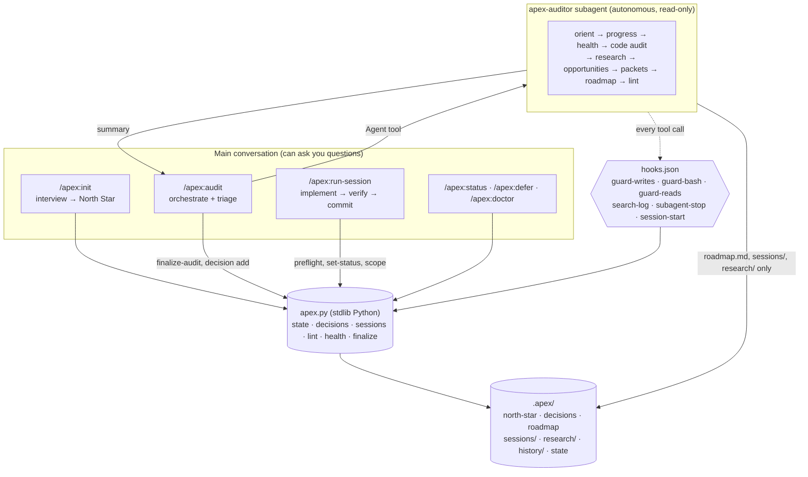

# Architecture

Apex splits the work three ways: **judgment** (the LLM), **bookkeeping** (a
deterministic Python CLI), and **enforcement** (Claude Code hooks).

## Why this split?
| Concern | Where it lives | Why |
|---|---|---|
| Asking the owner questions | Main thread (skills) | Subagents can't use `AskUserQuestion`. |
| Heavy reading and research | `apex-auditor` subagent | Keeps the main context clean; Opus at high effort; its own 50-turn budget. |
| IDs, append-only logs, status changes | `apex.py` | Deterministic; LLMs miscount and overwrite. |
| Score math, tier, history | `apex.py finalize-audit` | Reproducible; hysteresis needs memory of the previous tier. |
| "Read-only", "don't touch the North Star" | Hooks | Plugin agents ignore frontmatter `hooks`/`permissionMode`, so enforcement lives in `hooks/hooks.json`, filtered by `agent_type`. |
| Honesty of claims | `apex.py lint` (SubagentStop) | Rubric math, health evidence, URL provenance, packet schema, secrets. |

## Audit lifecycle
1. `/apex:audit` → `apex.py lock acquire` (no concurrent audits) → picks a mode.
2. The auditor reads state and runs `apex.py health`, which runs the user-approved checks and writes `.apex/.health.json`.
3. Every WebSearch/WebFetch result URL is appended to `.apex/.search-log.json` by a PostToolUse hook.
4. The auditor writes `roadmap.md` + packets and runs `apex.py lint` until it's clean. The SubagentStop hook won't let it finish otherwise.
5. Back in the main thread, `apex.py finalize-audit`:
   - checks lint again
   - computes the tier with ±0.3 hysteresis
   - regenerates the Mermaid trend chart and session graph
   - writes `.apex/history/<date>-audit.md`
   - updates `state.json` and releases the lock
6. Triage: the owner keeps or rejects packets. Rejections become `WF-###`/`DF-###` entries via `apex.py decision add`.

## Delta mode (token guard)
When `state.json.last_audit_sha` exists and the mode isn't `full`, the auditor:
- spends ~80% of its file reads on `git diff <last_sha>..HEAD`
- reuses its codebase map from its project memory (`.claude/agent-memory/apex*/MEMORY.md`)
- spot-checks 2-3 untouched modules

`quick` mode also skips web research and runs the auditor on Sonnet.

## Session packets and parallelism
- Session status lives **only** in each packet's frontmatter. `roadmap.md` holds a generated table, so two sessions finishing on different branches never conflict on a shared file.
- `parallel: safe` is linted: no target overlap with other active packets, and all dependencies done.
- `/apex:run-session` commits atomically on the current branch by default. `--branch`/`--worktree` opt into isolation.

## State files
| File | Written by | Committed? |
|---|---|---|
| `north-star.md` | `apex.py init` | yes |
| `decisions.md` | `apex.py decision add` | yes |
| `config.json` | `apex.py init` (then you) | yes |
| `state.json` | `apex.py finalize-audit` | yes |
| `roadmap.md` | auditor (+ generated regions) | yes |
| `sessions/S-###-*.md` | auditor; status via `apex.py` | yes |
| `research/competitors.md` | auditor | optional (gitignore if private) |
| `history/*.md` | `apex.py finalize-audit` | yes |
| `.search-log.json`, `.health.json`, `.lock` | hooks / `apex.py` | no (gitignored) |
