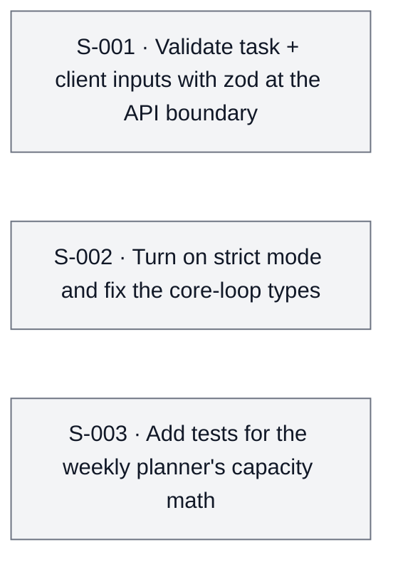

<!-- apex:snapshot {"date": "2026-09-14", "sha": "3f9c2e1", "score": 3.8, "tier": 1} -->
> Immutable snapshot of `.apex/roadmap.md` written by `apex.py finalize-audit`.

# Apex Roadmap — Tasklane (fictional demo)

<!-- apex:scorecard {"date": "2026-09-14", "mode": "full", "sha": "3f9c2e1", "overall": 3.8, "confidence": "medium", "research": "light", "health": {"status": "partial"}, "dimensions": {"core_loop": 4.5, "data_integrity": 3.5, "ux_onboarding": 3.5, "code_health": 4.0, "resilience": 3.0, "performance": 5.0, "testing": 2.5, "security": 4.0}} -->

> **North Star:** freelancers plan a realistic multi-client week in <60s · see `north-star.md`
> **Score 3.8 / 10 · Tier 1 · Foundations** — the planner works on the happy path, but unvalidated inputs and missing types put data at risk.

## Scorecard
| Dimension | Weight | Score | Confidence | Evidence |
|---|---:|---:|---|---|
| Core loop | 20 | 4.5 | high | `src/lib/planner.ts:88` capacity math works; no overbooking UI yet |
| Data integrity | 15 | 3.5 | high | `src/app/api/tasks/route.ts:18` writes unvalidated JSON |
| UX & onboarding | 15 | 3.5 | medium | blank dashboard on first login |
| Code health | 10 | 4.0 | high | `tsconfig.json:7` strict off |
| Resilience | 10 | 3.0 | medium | no error boundaries |
| Performance | 10 | 5.0 | low | small data sets only |
| Tests & CI | 10 | 2.5 | high | 2 tests, none on the planner |
| Security | 10 | 4.0 | medium | authZ checked on reads only |

### Score trend
<!-- apex:trend:start -->
```mermaid
xychart-beta
    title "Apex score over time"
    x-axis ["09-14"]
    y-axis "Score" 0 --> 10
    line [3.8]
```
<!-- apex:trend:end -->

## Health Check
| Check | Result | Notes |
|---|---|---|
| typecheck | pass | non-strict |
| lint | fail | 23 warnings treated as errors |

## Progress Since Last Audit
First audit.

## First 60 Seconds
Sign-up → empty dashboard → "New client" → "New task". **6 steps** to first plan; no template.

## Parity Matrix
| Workflow | Competitor | Verdict | Evidence | Source | Verified | Checked |
|---|---|---|---|---|---|---|
| Weekly planning | Acme Tasks (fictional) | Missing | They have a week view; we have a list | — | unverified | 2026-09-14 |

## Opportunities
| Slug | Opportunity | Impact | Effort (sessions) | ROI | Tier | Checked |
|---|---|---:|---:|---:|---:|---|
| `api-input-validation` | zod validation at API boundary | 5 | 1 | 5.0 | 1 | — |
| `strict-types` | Strict TypeScript on the core loop | 4 | 1 | 4.0 | 1 | — |
| `planner-tests` | Planner capacity tests | 4 | 1 | 4.0 | 1 | — |

**Decisions honored:** WF-001

## Session Plan
<!-- apex:sessions:start -->
| ID | Session | Model | Parallel | Depends on | Est. | Packet |
|----|---------|-------|----------|------------|------|--------|
| S-001 | Validate task + client inputs with zod at the API boundary | Sonnet · Standard Execution | Parallel-Safe | — | 1.5h | [S-001-validate-task-inputs.md](sessions/S-001-validate-task-inputs.md) |
| S-002 | Turn on strict mode and fix the core-loop types | Opus · Deep Architecture | Parallel-Safe | — | 2h | [S-002-strict-typescript.md](sessions/S-002-strict-typescript.md) |
| S-003 | Add tests for the weekly planner's capacity math | Sonnet · Standard Execution | Parallel-Safe | — | 1h | [S-003-planner-core-tests.md](sessions/S-003-planner-core-tests.md) |



_Statuses live in each packet's frontmatter; run `/apex:status` for live progress._
<!-- apex:sessions:end -->

## Questions for the owner
- Is a weekly calendar view in scope for v1?

## Next audit focus
- Verify S-001..S-003 landed; re-check lint.
