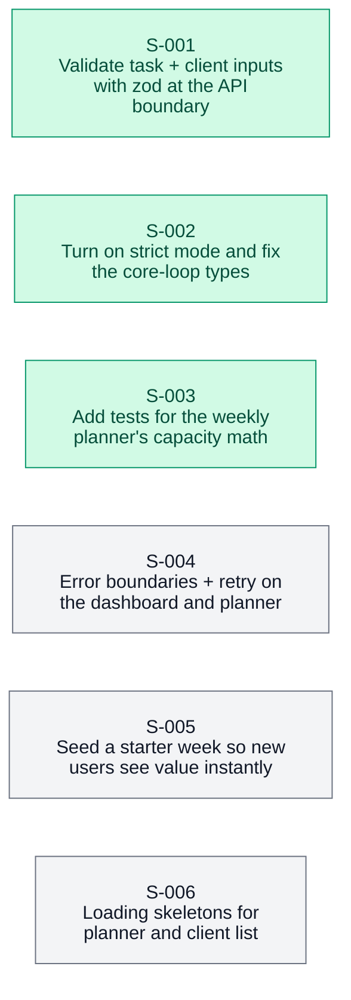

<!-- apex:snapshot {"date": "2026-10-12", "sha": "8b21d0a", "score": 5.1, "tier": 2} -->
> Immutable snapshot of `.apex/roadmap.md` written by `apex.py finalize-audit`.

# Apex Roadmap: Tasklane (fictional demo)

<!-- apex:scorecard {"date": "2026-10-12", "mode": "standard", "sha": "8b21d0a", "overall": 5.1, "confidence": "medium", "research": "full", "health": {"status": "pass"}, "dimensions": {"core_loop": 5.5, "data_integrity": 5.5, "ux_onboarding": 4.5, "code_health": 5.5, "resilience": 4.0, "performance": 5.0, "testing": 4.5, "security": 5.0}} -->

> **North Star:** freelancers plan a realistic multi-client week in <60s · see `north-star.md`
> **Score 5.1 / 10 · Tier 2 · Reliability.** Foundations are solid; first-run experience and error states now limit retention.

## Scorecard
| Dimension | Weight | Score | Confidence | Evidence |
|---|---:|---:|---|---|
| Core loop | 20 | 5.5 | high | overbooking warning shipped `src/lib/planner.ts:131` |
| Data integrity | 15 | 5.5 | high | zod at both API routes (S-001) |
| UX & onboarding | 15 | 4.5 | high | 6-step empty start |
| Code health | 10 | 5.5 | high | strict mode on (S-002) |
| Resilience | 10 | 4.0 | high | white screen on API 500 |
| Performance | 10 | 5.0 | low | unchanged |
| Tests & CI | 10 | 4.5 | high | planner tests (S-003); no CI yet |
| Security | 10 | 5.0 | medium | authZ on mutations |

### Score trend
<!-- apex:trend:start -->
```mermaid
xychart-beta
    title "Apex score over time"
    x-axis ["09-14", "10-12"]
    y-axis "Score" 0 --> 10
    line [3.8, 5.1]
```
<!-- apex:trend:end -->

## Health Check
| Check | Result | Notes |
|---|---|---|
| typecheck | pass | strict |
| lint | pass | |
| test | pass | 19 tests |
| build | pass | |

## Progress Since Last Audit
- **Sessions done:** S-001, S-002, S-003 (all planned work landed) · **Off-plan:** overbooking banner
- Tier 1 → Tier 2.

## First 60 Seconds
Still **6 steps** to a first plan; Acme Tasks needs 3.

## Parity Matrix
| Workflow | Competitor | Verdict | Evidence | Source | Verified | Checked |
|---|---|---|---|---|---|---|
| Weekly planning | Acme Tasks (fictional) | Matches | Both have a week view | https://acmetasks.example.com/features | verified | 2026-10-12 |
| Overbooking warning | Acme Tasks (fictional) | Beats | They have no capacity model | https://forum.example.com/t/acme-tasks-weekly-planning-is-painful/4411 | verified | 2026-10-12 |

## Opportunities
| Slug | Opportunity | Impact | Effort (sessions) | ROI | Tier | Checked |
|---|---|---:|---:|---:|---:|---|
| `error-boundaries` | Error boundaries + retry | 4 | 1 | 4.0 | 2 | - |
| `starter-template` | Starter week template | 5 | 1 | 5.0 | 2 | - |
| `loading-skeletons` | Loading skeletons | 3 | 1 | 3.0 | 2 | - |

**Decisions honored:** WF-001 · **Filtered (anti-bloat):** team workspaces

## Session Plan
<!-- apex:sessions:start -->
| ID | Session | Model | Parallel | Depends on | Est. | Packet |
|----|---------|-------|----------|------------|------|--------|
| S-001 | Validate task + client inputs with zod at the API boundary | Sonnet · Standard Execution | Parallel-Safe | - | 1.5h | [S-001-validate-task-inputs.md](sessions/S-001-validate-task-inputs.md) |
| S-002 | Turn on strict mode and fix the core-loop types | Opus · Deep Architecture | Parallel-Safe | - | 2h | [S-002-strict-typescript.md](sessions/S-002-strict-typescript.md) |
| S-003 | Add tests for the weekly planner's capacity math | Sonnet · Standard Execution | Parallel-Safe | - | 1h | [S-003-planner-core-tests.md](sessions/S-003-planner-core-tests.md) |
| S-004 | Error boundaries + retry on the dashboard and planner | Sonnet · Standard Execution | Parallel-Safe | - | 1.5h | [S-004-dashboard-error-boundaries.md](sessions/S-004-dashboard-error-boundaries.md) |
| S-005 | Seed a starter week so new users see value instantly | Sonnet · Standard Execution | Parallel-Safe | - | 1.5h | [S-005-starter-week-template.md](sessions/S-005-starter-week-template.md) |
| S-006 | Loading skeletons for planner and client list | Sonnet · Standard Execution | Parallel-Safe | - | 1h | [S-006-loading-skeletons.md](sessions/S-006-loading-skeletons.md) |



_Statuses live in each packet's frontmatter; run `/apex:status` for live progress._
<!-- apex:sessions:end -->

## Questions for the owner
- Calendar sync: build now or defer?

## Next audit focus
- Onboarding funnel after S-005.
