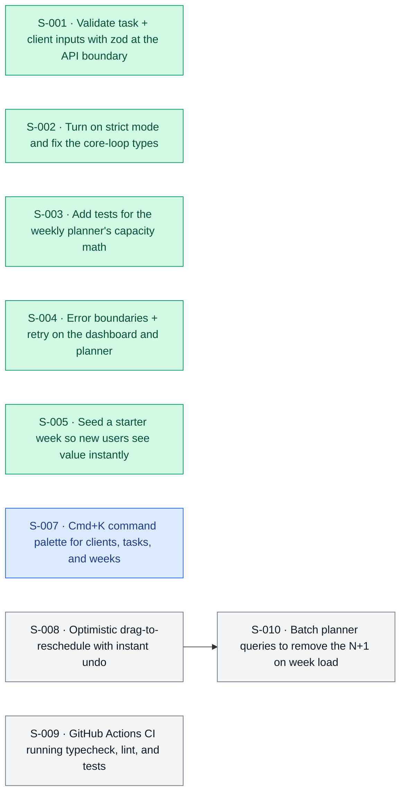

<!-- apex:snapshot {"date": "2026-11-07", "sha": "c47e9f2", "score": 6.8, "tier": 2} -->
> Immutable snapshot of `.apex/roadmap.md` written by `apex.py finalize-audit`.

# Apex Roadmap: Tasklane (fictional demo)

<!-- apex:scorecard {"date": "2026-11-07", "mode": "standard", "sha": "c47e9f2", "overall": 6.8, "confidence": "medium", "research": "full", "health": {"status": "pass"}, "dimensions": {"core_loop": 8.0, "data_integrity": 7.0, "ux_onboarding": 6.5, "code_health": 7.5, "resilience": 6.0, "performance": 6.5, "testing": 6.0, "security": 6.0}, "delta_justification": "+1.7: S-004 and S-005 shipped (error boundaries, starter week cut onboarding from 6 to 2 steps), CI-ready test suite grew from 19 to 47 tests, and data layer gained transactions in src/lib/planner-data.ts:61."} -->

> **North Star:** freelancers plan a realistic multi-client week in <60s · see `north-star.md`
> **Score 6.8 / 10 · Tier 2 · Reliability.** Reliable and pleasant for early adopters; now win on speed and keyboard flow where both competitors are weak.

## Scorecard
| Dimension | Weight | Score | Confidence | Evidence |
|---|---:|---:|---|---|
| Core loop & functionality | 20 | 8.0 | high | starter week → plan in 2 steps `src/app/onboarding/page.tsx:22`; overbooking banner `src/lib/planner.ts:131` |
| Data & schema integrity | 15 | 7.0 | high | zod at boundaries; transactions `src/lib/planner-data.ts:61` |
| UX states & onboarding | 15 | 6.5 | high | error boundaries (S-004); skeletons still missing on planner |
| Type safety & code health | 10 | 7.5 | high | strict TS, 3 `as any` left `src/lib/legacy-import.ts` |
| Error handling & resilience | 10 | 6.0 | medium | retry UI; no offline handling for drags |
| Performance | 10 | 6.5 | medium | N+1 on week load `src/lib/planner-data.ts:27` |
| Tests & CI | 10 | 6.0 | high | 47 tests pass; no CI workflow |
| Security & privacy | 10 | 6.0 | medium | authZ on all mutations; no rate limit on `/api/auth` |

### Score trend
<!-- apex:trend:start -->
```mermaid
xychart-beta
    title "Apex score over time"
    x-axis ["09-14", "10-12", "11-07"]
    y-axis "Score" 0 --> 10
    line [3.8, 5.1, 6.8]
```
<!-- apex:trend:end -->

## Health Check
| Check | Result | Notes |
|---|---|---|
| typecheck (`pnpm exec tsc --noEmit`) | pass | 0 errors |
| lint (`pnpm run lint`) | pass | 0 warnings |
| test (`pnpm run test`) | pass | 47 passed |
| build (`pnpm run build`) | pass | 41s |

## Progress Since Last Audit
- **Commits:** 23 since `8b21d0a` · **Sessions done:** S-004, S-005 · **Dropped:** S-006 (superseded by S-008's streaming approach)
- **Plan vs. actual:** 2 of 3 planned sessions shipped; off-plan work added transactions to the data layer (good call).
- **Regressions:** none.

## First 60 Seconds
1. Sign-up (email + password) → 2. **"Start with sample week"** → planner with a populated week.
- Steps to first value: **2** (Acme Tasks: 3, Boardly: 4) · Remaining friction: sample data can't be cleared in one click.

## Parity Matrix
| Workflow | Competitor | Verdict | Evidence | Source | Verified | Checked |
|---|---|---|---|---|---|---|
| Weekly planning | Acme Tasks (fictional) | Matches | Both offer a week grid | https://acmetasks.example.com/features | verified | 2026-11-07 |
| Overbooking warning | Acme Tasks (fictional) | Beats | No capacity model on their side | https://forum.example.com/t/acme-tasks-weekly-planning-is-painful/4411 | verified | 2026-11-07 |
| Starter templates | Boardly (fictional) | Matches | Both seed a sample workspace | https://boardly.example.com/templates | verified | 2026-11-07 |
| Keyboard navigation | Boardly (fictional) | Missing | Neither of us has a palette; their users ask for it | https://reviews.example.com/boardly/cons | verified | 2026-11-07 |
| Free tier limits | Acme Tasks (fictional) | Matches | Similar 3-project cap | https://acmetasks.example.com/pricing | verified | 2026-11-07 |
| Offline drag & drop | Boardly (fictional) | Missing | Not verified this run | - | unverified | 2026-11-07 |

### Competitor weaknesses we can exploit
- **Acme Tasks:** drag-and-drop is described as "laggy" (forum thread) → optimistic moves + instant undo (S-008).
- **Boardly:** no keyboard-first flow in reviews' "cons" → Cmd+K palette (S-007).

## Opportunities
| Slug | Opportunity | Impact | Effort (sessions) | ROI | Tier | Checked |
|---|---|---:|---:|---:|---:|---|
| `cmd-k-palette` | Cmd+K command palette | 4 | 1 | 4.0 | 3 | - |
| `ci-pipeline` | CI for health checks | 3 | 0.5 | 6.0 | 2 | - |
| `optimistic-reschedule` | Optimistic reschedule + undo | 5 | 1.5 | 3.3 | 2 | - |
| `planner-n-plus-one` | Batch planner queries | 3 | 1 | 3.0 | 2 | - |

**Filtered out (anti-bloat):** team workspaces, Zapier integration · **Decisions honored:** WF-001 (SSO), DF-001 (calendar sync, revisit 2027-01-15)

## Session Plan
<!-- apex:sessions:start -->
| ID | Session | Model | Parallel | Depends on | Est. | Packet |
|----|---------|-------|----------|------------|------|--------|
| S-001 | Validate task + client inputs with zod at the API boundary | Sonnet · Standard Execution | Parallel-Safe | - | 1.5h | [S-001-validate-task-inputs.md](sessions/S-001-validate-task-inputs.md) |
| S-002 | Turn on strict mode and fix the core-loop types | Opus · Deep Architecture | Parallel-Safe | - | 2h | [S-002-strict-typescript.md](sessions/S-002-strict-typescript.md) |
| S-003 | Add tests for the weekly planner's capacity math | Sonnet · Standard Execution | Parallel-Safe | - | 1h | [S-003-planner-core-tests.md](sessions/S-003-planner-core-tests.md) |
| S-004 | Error boundaries + retry on the dashboard and planner | Sonnet · Standard Execution | Parallel-Safe | - | 1.5h | [S-004-dashboard-error-boundaries.md](sessions/S-004-dashboard-error-boundaries.md) |
| S-005 | Seed a starter week so new users see value instantly | Sonnet · Standard Execution | Parallel-Safe | - | 1.5h | [S-005-starter-week-template.md](sessions/S-005-starter-week-template.md) |
| S-007 | Cmd+K command palette for clients, tasks, and weeks | Sonnet · Standard Execution | Parallel-Safe | - | 1.5h | [S-007-cmd-k-palette.md](sessions/S-007-cmd-k-palette.md) |
| S-008 | Optimistic drag-to-reschedule with instant undo | Opus · Deep Architecture | Parallel-Safe | - | 2h | [S-008-optimistic-task-moves.md](sessions/S-008-optimistic-task-moves.md) |
| S-009 | GitHub Actions CI running typecheck, lint, and tests | Sonnet · Standard Execution | Parallel-Safe | - | 0.75h | [S-009-ci-health-workflow.md](sessions/S-009-ci-health-workflow.md) |
| S-010 | Batch planner queries to remove the N+1 on week load | Sonnet · Standard Execution | Depends | S-008 | 1.5h | [S-010-planner-query-batching.md](sessions/S-010-planner-query-batching.md) |



_Statuses live in each packet's frontmatter; run `/apex:status` for live progress._
<!-- apex:sessions:end -->

## Questions for the owner
- Should sample data auto-expire after the first real client is added?

## Next audit focus
- Re-verify drag latency after S-008; spot-check `src/lib/legacy-import.ts`.
